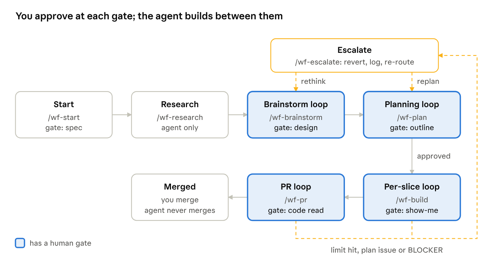

# Agentic workflow for Cursor

Skills, subagents, a stop hook and templates that turn a manual research -> plan -> implement -> review
routine in [Cursor](https://cursor.com) into a gated, mostly agentic workflow for software features and bug
fixes. Built for regulated (medical-device) software, where traceability and human sign-off matter.



- **Docs site:** [robbietuk.github.io/gated-agent-workflow](https://robbietuk.github.io/gated-agent-workflow/) - the guide, slides and cheat sheet as web pages (sources in [`docs/`](docs)).
- **Guide:** [docs/guide/index.html](docs/guide/index.html) (Markdown source: [docs/guide.md](docs/guide.md)) - tracks, walkthroughs, gates, limits, setup, FAQ.
- **Slides:** [docs/slides/index.html](docs/slides/index.html) - 17 slides with speaker notes; arrow keys to move.
- **Cheat sheet:** [docs/cheatsheet.html](docs/cheatsheet.html) - one printable page with every command.
- **Kit:** everything under [`.cursor/`](.cursor) and [`.workflow/templates/`](.workflow/templates) - copy into your repo root.

> Status: the formats follow Cursor's documentation (Cursor 2.4+), and the stop hook has a self-test
> (`bash .cursor/hooks/test-stop-gate.sh`), but the kit has not yet been exercised end to end inside Cursor.
> Try it on a small change first and open an issue with what you find.

---

## About the kit

A drop-in set of Cursor skills, subagents, a stop hook and templates that turns a manual
research -> plan -> implement -> review routine into a gated, mostly agentic workflow. The rule is
**manual where you think, agentic where it builds**: you own the *what* (spec, design, outline, final code
read); the agent owns the *how* (research, implement, test, self-review); **tests decide when a slice is
done**. Every stage writes a short artifact into `.workflow/<date>-<slug>/`, every loop has an iteration
limit, and every limit ends in an explicit escalation back to you, which suits regulated work where
traceability matters.

```
             you                        agent                          you
  /wf-start ------> spec.md + questions.md
                         |
  /wf-research           +--> researcher (sees questions ONLY) --> research.md
                         |
  /wf-brainstorm    <---- one question at a time, 2-3 approaches ----> design.md   [you approve]
                         |
  /wf-plan          <---- vertical slices + req IDs + tests ---------> outline.md  [you approve]
                         |
  /wf-build   per slice: lock failing tests -> implement (stop hook: build+test, max 5)
                         -> slice-reviewer (spec, then quality; max 3 rounds)
                         -> show-me ----------------------------------> [you approve] -> commit
                         |
  /wf-pr            pr-description.md -> 5 lens-reviewers -> finding-verifier
                         -> fix NIT/IMPORTANT (max 2 rounds) ----------> your code read
                         |
  /wf-escalate  <--- any limit hit / plan issue / you say no:
                     revert (you confirm) -> decisions.md -> back to /wf-brainstorm or /wf-plan

  Bug track:   /wf-start -> /wf-debug (reproduce, lock regression test, root cause) [you approve] -> /wf-build -> /wf-pr
  Small change: /wf-start -> /wf-plan (one slice) [you approve] -> /wf-build -> /wf-pr
```

## What is in the kit

| Path | What |
|---|---|
| `.cursor/skills/wf-start` ... `wf-pr` | Eight skills, invoked as `/wf-start`, `/wf-research`, `/wf-brainstorm`, `/wf-plan`, `/wf-build`, `/wf-debug`, `/wf-escalate`, `/wf-pr` |
| `.cursor/agents/` | Read-only subagents: `researcher`, `slice-reviewer`, `lens-reviewer`, `finding-verifier` |
| `.cursor/hooks.json`, `.cursor/hooks/stop-gate.sh` | Stop hook: in build phase, guards locked tests and runs build + tests after every agent turn |
| `.cursor/hooks/test-stop-gate.sh` | Self-test for the hook (temp git repo, all scenarios, JSON validation) |
| `.cursor/workflow.env` | Your build/test commands and the iteration limits |
| `.cursor/rules/agentic-workflow.mdc` | Always-on guardrails (locked tests, limits, escalate, no merge/push) |
| `.workflow/templates/` | `spec.md`, `bug-report.md`, `design.md`, `outline.md`, `decisions.md`, `pr-description.md` |

## Requirements

- **Cursor 2.4 or later.** Skills, custom subagents and the improved `stop` hook arrived in 2.4
  (January 2026). On an older version the `/wf-*` skills and subagents will not appear.
- Hooks run only in a **trusted workspace**, and an enterprise admin can restrict hooks, skills or
  subagents. If `/wf` shows nothing or the hook never fires, check those settings first.
- `bash` and `git` on the PATH Cursor uses (the hook command is `bash .cursor/hooks/stop-gate.sh`).

## Install

1. Copy `.cursor/`, `.workflow/` into your repository root (merge with an existing `.cursor/` if you have
   one; if you already have a `hooks.json`, add the `stop` entry to it).
2. Edit `.cursor/workflow.env`: set `TEST_CMD` (required) and `BUILD_CMD` (optional; leave empty if the test
   command builds). Both run from the repo root with `bash -c`. Examples:
   `BUILD_CMD="cmake --build build -j"` / `TEST_CMD="ctest --test-dir build --output-on-failure"`, or
   `TEST_CMD="dotnet test"`, or `TEST_CMD="pytest -q"`.
3. Make the scripts executable: `chmod +x .cursor/hooks/*.sh`
4. Check the hook: `bash .cursor/hooks/test-stop-gate.sh` (needs `git` and `python3`). All lines should say PASS.
5. Restart Cursor (or reload the window) so it picks up skills, subagents and hooks. Type `/wf` in the agent
   chat to see the skills.
6. Decide whether `.workflow/` work folders are committed (traceability record) or ignored. To ignore all
   but the templates, add to `.gitignore`:
   ```
   .workflow/*
   !.workflow/templates/
   ```
   Either way `.workflow/active.env` and `*/last-run.log` are local state; ignoring them is sensible.

**Windows:** the hook is a bash script. Cursor must be able to run it with bash: install Git for Windows
(Git Bash) or use WSL, and make sure `bash` is on the PATH Cursor sees. The skills and subagents work
without the hook, but then nothing enforces the implement-loop limit or locked tests automatically.

**Before the first `/wf-build`,** make sure the existing test suite is green. In build phase the hook runs
the suite after every turn; a suite that is already red would burn the run budget.

## Quick start

### Feature
```
/wf-start        describe the feature; answer one question at a time; approve spec.md and questions.md
/wf-research     agent researches the code (researcher sees only questions.md) -> research.md
/wf-brainstorm   pick one of 2-3 approaches; approve design.md (~200 lines)
/wf-plan         approve outline.md (vertical slices with req IDs and tests)
/wf-build        per slice: tests locked, implemented, reviewed, shown to you -> approve -> commit
/wf-build        ...repeat for each slice
/wf-pr           PR description + whole-branch review; you do the final code read
```

### Bug
```
/wf-start        triage as bug; fill bug-report.md (observed, expected, steps, device/firmware, severity, IDs)
/wf-debug        reproduce, lock a failing regression test, root cause with evidence -> you approve fix approach
/wf-build        one slice: implement the fix until the locked test passes; review; show-me; commit
/wf-pr           PR description + branch review; your code read
```
If the root cause is a design flaw, `/wf-debug` sends you to `/wf-brainstorm` instead.

### Small change (about an hour, 1-3 files, no new behaviour worth designing)
```
/wf-start        triage as small; short spec.md
/wf-plan         one-slice outline -> approve
/wf-build        lock tests, implement, review, show-me, commit
/wf-pr
```

### Moving between stages
Every `/wf-*` command ends by asking **"Continue with `/wf-<next>` now?"**. Say yes and it carries on in the
same chat; say no and run the next command later (or in a fresh chat). It never moves on without a yes.

### When something goes wrong
`/wf-escalate` at any time. The agent runs it itself when a limit is hit. It stops work, proposes how to
undo the slice (you confirm any git command), logs a dated entry in `decisions.md`, and routes back to
`/wf-brainstorm` (rethink) or `/wf-plan` (replan).

## Where artifacts live

```
.workflow/
  active.env                      # WORK_DIR, TRACK, PHASE, SLICE, LOCK_SHA for the current work item
  templates/                      # copied by the skills
  2026-11-20-alarm-limit-sync/    # one folder per work item: <YYYY-MM-DD>-<slug>
    spec.md | bug-report.md       # what, why, done (you + agent)
    questions.md                  # factual questions for the researcher
    research.md                   # facts with file:line refs, no opinions
    design.md                     # approved design (~200 lines)
    outline.md                    # slices, acceptance criteria, status, review-round counters
    decisions.md                  # dated decisions and escalations
    locked-tests.txt              # test files that must not change after their lock commit
    last-run.log                  # last stop-hook build+test output
    pr-description.md             # PR body
```

`PHASE` is one of `start | research | brainstorm | plan | build | pr | escalated`. The stop hook only acts
when `PHASE=build`, which `/wf-build` sets when it starts (planning and debugging hand off with
`PHASE=plan`, so the hook never fires at the end of a planning or debugging turn).

## Limits

| Loop | Limit | On limit | Enforced by |
|---|---|---|---|
| Implement (stop hook build+test runs) | 5 runs (`MAX_STOP_RUNS`) | `/wf-escalate` "stop-hook cap" | hook (`loop_count`) |
| Slice review -> fix | 3 rounds (`MAX_REVIEW_ROUNDS`) | `/wf-escalate` | wf-build skill (counter in outline.md) |
| PR fix -> re-run | 2 rounds (`MAX_PR_FIX_ROUNDS`) | `/wf-escalate` | wf-pr skill |
| Brainstorm, planning | none (you are in the loop) | more than 3 planning rounds: revisit the spec | you |

Never: keep going past a limit, or edit/loosen a locked test. The hook detects locked-test edits
(committed or not) against `LOCK_SHA` and tells the agent to restore them.

## How it enforces things

- **Locked tests.** `/wf-build` (or `/wf-debug` for bugs) writes the slice's tests first, runs them, confirms
  they fail for the right reason, commits `test(<slice>): lock failing tests`, records `LOCK_SHA` in
  `active.env` and the files in `locked-tests.txt`. After that the hook rejects any change to those files.
- **Stop hook.** After each agent turn in build phase: locked-test check, then `BUILD_CMD` and `TEST_CMD`.
  Pass: silent. Fail: auto-submits "Build/tests failing (run N of 5). Fix the code, not the tests." with the
  last 40 lines of output. On the 5th failing run: "stop changing code; run /wf-escalate". Cursor's own
  `loop_limit: 6` is a backstop above that. `loop_count` counts the hook's own follow-ups in an agent run;
  if you step in with a message, counting may start over, so treat the cap as "how long the agent may churn
  on its own" and keep an eye on the slice counters in `outline.md`.
- **Fresh reviewers.** Subagents start with a clean context and are read-only; the skills pass them
  everything they need explicitly.

## Tuning

- **Limits:** change the numbers in `.cursor/workflow.env`. Keep `loop_limit` in `.cursor/hooks.json` at
  least `MAX_STOP_RUNS + 1` so the escalation message can be delivered.
- **Slow suites:** point `TEST_CMD` at a fast subset (e.g. the module's tests) and let `/wf-pr` run the full
  suite; raise `timeout` in `hooks.json` (seconds) if needed.
- **Models:** subagents use `model: inherit`. Set a specific model in the agent frontmatter if you want
  cheaper research or a stronger reviewer.
- **Lenses:** edit `.cursor/agents/lens-reviewer.md` and `wf-pr/references/branch-review.md` to add or
  change lenses (e.g. cybersecurity, performance).
- **Templates:** edit `.workflow/templates/` to match your SRS / hazard-analysis IDs and PR template.
- **Auto-invocation:** the skills allow model invocation with precise descriptions. To make a skill run
  only when typed, add `disable-model-invocation: true` to its frontmatter.

## Credits

- Brainstorming, planning, build loop, TDD, debugging and review skills are adapted from
  [obra/superpowers](https://github.com/obra/superpowers) v7.0.2 (MIT, Copyright (c) 2025 Jesse Vincent).
  See `THIRD-PARTY-NOTICES.md` for the license and the file-by-file mapping.
- Research-plan-implement flow and short design/outline artifacts follow HumanLayer's RPI/CRISPY lessons.
- Hook, skill and subagent formats follow the Cursor documentation (`hooks.json` v1, `stop` hook with
  `followup_message` and `loop_count`, skills in `.cursor/skills`, subagents in `.cursor/agents`).
