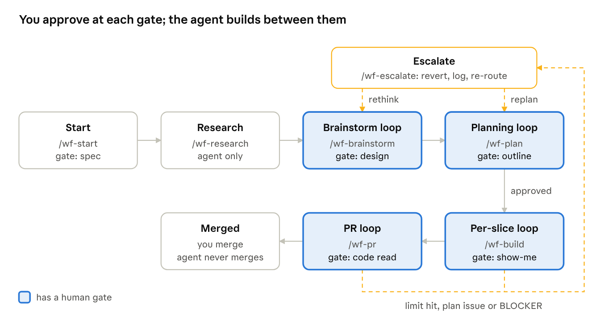

# Agentic workflow guide

*Last updated: 2026-11-20*

## 1. What this is

This guide explains how to run software features and bug fixes through a staged, agent-assisted workflow in Cursor. A kit of skills, subagents, a hook and templates lives in your repo; you drive it with /wf-\* commands. Every work item leaves a trail of short Markdown files in `.workflow/<YYYY-MM-DD>-<slug>/`. The aim is to let the agent do the building while you keep control of what gets built and what gets merged.

**Principle: manual where you think, agentic where it builds.**

| Who   | Owns         | In practice                                |
|-------|--------------|--------------------------------------------|
| You   | The **what** | Spec, design, outline, final code read     |
| Agent | The **how**  | Research, implement, test, self-review     |
| Tests | **Done**     | A slice is done when its locked tests pass |

## 2. The workflow at a glance

A feature runs through seven stages; you hold the gates, the agent does the work between them.

Feature track · 7 stages, 2 escalation routes

Work flows left to right, then down into the build; a hit limit, plan issue or BLOCKER goes to Escalate, which routes back to brainstorm (rethink) or plan (replan).

| \#  | Stage           | Command        | Owner                        | Input                                 | Output artifact                                                | Gate                                                      |
|-----|-----------------|----------------|------------------------------|---------------------------------------|----------------------------------------------------------------|-----------------------------------------------------------|
| 1   | Start           | `/wf-start`      | You (agent drafts questions) | Your request or bug report            | `spec.md` (or `bug-report.md`), `questions.md`, `.workflow/active.env` | Track chosen, spec agreed                                 |
| 2   | Research        | `/wf-research`   | Agent (researcher subagent)  | `questions.md` only                     | `research.md` (facts, file:line refs, no opinions)               | None                                                      |
| 3   | Brainstorm loop | `/wf-brainstorm` | You + agent                  | spec, research                        | `design.md` (~200 lines)                                         | **You approve design**                                    |
| 4   | Planning loop   | `/wf-plan`       | Agent drafts, you approve    | `design.md`                             | `outline.md` (vertical slices)                                   | **You approve outline** (then `/wf-build` sets `PHASE=build`) |
| 5   | Per-slice loop  | `/wf-build`      | Agent; you at show-me        | One slice of `outline.md`               | Locked tests, code, commits, `locked-tests.txt`                  | Tests pass, review clean, **you approve show-me**         |
| 6   | PR loop         | `/wf-pr`         | Agent, then you              | Whole branch, `design.md`, `decisions.md` | `pr-description.md`, ranked findings                             | **Your code read** (agent never merges)                   |
| 7   | Escalate        | `/wf-escalate`   | You                          | A hit limit or a plan issue           | Dated entry in `decisions.md`, slice reverted                    | You pick rethink or replan                                |

### Definitions

- **Spec** (`spec.md`): what you want, why, and how you will know it is done. Written with you at `/wf-start`.

- **Research** (`research.md`): facts about the current code, with file:line references and no opinions. Written by the researcher subagent, which sees only `questions.md`, never the spec or design.

- **Design doc** (`design.md`): about 200 lines covering current state, desired end state, patterns to follow, decisions, open questions, and risks/hazards.

- **Outline** (`outline.md`): the plan as a list of vertical slices.

- **Slice**: one thin, end-to-end piece of work with an id, req IDs, acceptance criteria, tests to write, files likely touched and a risk flag.

- **Locked tests**: tests written from a slice's acceptance criteria, confirmed to FAIL, then committed as test(\<slice\>): lock failing tests. The commit is LOCK_SHA; the files are listed in `locked-tests.txt`. Nobody edits or loosens them.

- **Stop hook**: `stop-gate.sh` in the plugin's `hooks/` folder (or `.cursor/hooks/` after a copy install), run by Cursor or Claude Code after each agent turn. It runs build + tests and sends the agent back to work until they pass, up to 5 runs.

- **Show-me**: the end of each slice. The agent shows a summary, how to run it, the diff stat and test evidence; you approve before it commits.

- **Branch review**: the PR-stage review of the whole branch diff against `design.md`, using parallel lens reviewers and a verify pass.

- **Escalate**: stop, revert the slice, log what was learned, and route back to brainstorm (rethink) or plan (replan). Run with `/wf-escalate`.

- **Decision log** (`decisions.md`): dated entries of trigger, what we learned, decision and affected req IDs. It feeds the PR description.

## 3. Choosing a track

`/wf-start` triages every item into one of three tracks; you confirm the choice. When in doubt, pick the heavier track.

| Signals                                                                               | Track            | Path                                                                                                                         |
|---------------------------------------------------------------------------------------|------------------|------------------------------------------------------------------------------------------------------------------------------|
| New behaviour, choices to make, several files or modules, req IDs to trace            | **Feature**      | spec → questions → research → brainstorm loop → planning loop → per-slice loop → PR loop                                     |
| Existing behaviour is wrong, you can describe expected vs actual, a repro is possible | **Bug**          | bug report → reproduce → failing regression test (locked) → root cause → you approve root cause + fix → one-slice build → PR |
| About an hour, 1–3 files, no new behaviour worth designing                            | **Small change** | spec → one-slice outline (you approve) → build → PR                                                                          |

**Examples from device software**

| Example                                                                                          | Track        | Why                                                           |
|--------------------------------------------------------------------------------------------------|--------------|---------------------------------------------------------------|
| Add a new configuration parameter for an instrument (stored, validated, synced, shown in the UI) | Feature      | New behaviour across layers; design choices; several req IDs  |
| A sync message is dropped after reconnect                                                        | Bug          | Existing behaviour is wrong; reproducible; needs a root cause |
| Fix a typo in a UI label or a log message                                                        | Small change | One or two files; nothing to design                           |

A bug whose root cause turns out to be a design flaw moves to the brainstorm loop (see section 5).

## 4. Feature walkthrough

A feature goes from `/wf-start` to a merged PR in seven steps, with four points where you must approve.

Every command ends by asking “Continue with the next command now?”. Say yes and it carries on in the same chat; say no and run the next command later, or in a fresh chat. It never moves on without a yes. It also recommends where: keep going in the same chat through spec, research, brainstorm and plan, then start a new chat for `/wf-build` and for `/wf-pr` (and for later slices once a chat gets long). Every stage reads its inputs from `.workflow/`, so a new chat loses nothing and keeps the agent's context small.

Each stage names the chat it runs in, `<topic> · /wf-<stage>`: the branch when you are on a feature branch, otherwise the work-item folder (for example `feature/network-probe · /wf-build`). When a hand-off recommends a new chat, it proposes that title. Cursor renames the chat itself where its rename tool is available; otherwise, and in Claude Code (`/rename <title>`), the skill prints the title for you to set.

1.  **Start: `/wf-start`**

    - You: describe the feature; confirm the Feature track; agree `spec.md` (what, why, done).

    - Agent: creates the work folder, writes `.workflow/active.env` (WORK_DIR, TRACK, PHASE, SLICE, LOCK_SHA), drafts `questions.md` from the spec.

    - Files: `spec.md`, `questions.md`.

2.  **Research: `/wf-research`**

    - You: nothing; optionally skim `research.md`.

    - Agent: the researcher subagent gets `questions.md` only, so its facts are not bent towards a solution.

    - Files: `research.md` (facts, file:line refs, no opinions).

3.  **Brainstorm loop: `/wf-brainstorm`**

    - You: answer one question at a time; pick between 2–3 approaches with trade-offs; revise until you approve.

    - Agent: asks, proposes, drafts `design.md`. Your approval triggers planning.

    - Files: `design.md`.

4.  **Planning loop: `/wf-plan`**

    - You: answer questions about gaps and choices; approve the outline, or say "rework" to send it back to brainstorm.

    - Agent: drafts `outline.md`. Approval hands off to `/wf-build`, which sets `PHASE=build` when it starts, so the stop hook never fires at the end of a planning turn.

    - Files: `outline.md`.

5.  **Per-slice loop: `/wf-build`** (repeat per slice)

    - Agent: (a) locks failing tests and commits test(\<slice\>): lock failing tests; (b) implements while the stop hook runs build + tests after each turn; (c) gets a two-stage review from a fresh slice-reviewer; (d) presents show-me.

    - You: approve show-me → agent commits → next slice.

    - Files: `locked-tests.txt`; commits on the branch; `active.env` tracks SLICE and LOCK_SHA.

6.  **PR loop: `/wf-pr`**

    - Agent: writes `pr-description.md` (summary, req IDs covered, test evidence, decisions from the log, known risks); runs the branch review; fixes NITs and IMPORTANTs; escalates BLOCKERs.

    - You: read the code; approve or send back. Nits are fixed in the PR.

    - Files: `pr-description.md`.

7.  **Merge**: you merge. The agent never merges.

At any point a limit or plan issue can stop the loop: see sections 8 and 9.

### Writing a good spec

- **What**: the behaviour, in one or two sentences a tester could check.

- **Why**: the user need or requirement, with req IDs.

- **Done**: observable acceptance criteria; these become tests.

- **Constraints**: platforms, timing, memory, interfaces you must not break, standards.

- **Out of scope**: what this item will not do. This stops the agent from "helpfully" growing the change.

### Approving the design doc

- Current state matches `research.md`, not guesses.

- Desired end state is concrete enough to test.

- Patterns to follow point to real code in the repo.

- Each decision says why; rejected options are named.

- Open questions are answered or explicitly deferred.

- Risks/hazards cover safety, concurrency and error paths.

- It is short (about 200 lines). Long means unclear.

### Approving the outline

- Slices are **vertical**: each cuts through every layer it needs and can be run, not "all the data layer first".

- **Slice 1 is a thin end-to-end slice** that proves the path works.

- Every slice has an id, req IDs, acceptance criteria, tests to write, files likely touched and a risk flag.

- Every req ID in the spec is covered by at least one slice.

- Tests are named per slice and test behaviour, not internals.

- Risky slices are flagged so you know where to look hardest at show-me.

## 5. Bug walkthrough

A bug goes from report to PR through a locked regression test and a root cause you approve; there is no design or outline stage unless the root cause demands one.

1.  **`/wf-start` (bug)**: you and the agent write `bug-report.md` in place of `spec.md`: what happens, what should happen, how to trigger it, req IDs affected. The agent drafts `questions.md`.

2.  **Reproduce** (`/wf-debug`): the agent reproduces the failure and records how.

3.  **Lock a failing regression test**: the agent writes a test that shows the bug, runs it, confirms it **fails**, and commits test(\<slice\>): lock failing tests. LOCK_SHA and `locked-tests.txt` are recorded.

4.  **Root cause with evidence**: logs, traces, file:line references and the chain from cause to symptom. No guesses.

5.  **You approve root cause + fix approach.** This is the bug track's design gate.

6.  **One-slice build loop** (`/wf-build`): implement, stop hook, two-stage review, show-me, commit.

7.  **PR loop** (`/wf-pr`): PR description, branch review, your code read.

**Example**: a sync message is dropped after reconnect. The locked test reconnects a session and asserts the queued message arrives; it fails today. The root cause might be a send queue cleared on reconnect, shown by a trace and the line that clears it.

**Bounce to brainstorm when** the root cause is a design flaw: for example, two components own the same state, or the protocol cannot express the case. Run `/wf-escalate`, log it, and continue on the Feature path from `/wf-brainstorm`.

**Rules**

- No fix without a root cause.

- The regression test must fail before the fix, and pass after it.

- The regression test is locked: never edited or loosened to make it pass.

## 6. Small change walkthrough

A small change skips research, brainstorm and design, but keeps an approved outline, the build loop and the PR loop.

**Fits when**: about an hour of work, 1–3 files, no new behaviour worth designing. Example: a typo in a UI label or a log message.

1.  `/wf-start`: confirm Small change; agree a short `spec.md`.

2.  `/wf-plan`: the agent writes a one-slice `outline.md`; **you approve** it.

3.  `/wf-build`: lock tests, implement, review, show-me, commit.

4.  `/wf-pr`: PR description, branch review, your code read.

If the work grows past 1–3 files or turns up a real design choice, escalate and move it to the Feature track.

## 7. Gates and loops

There are four human gates; each has a short checklist. The agent-run loops between them (implement, slice review, PR fixes) are bounded by limits (section 8).

**Design gate** (end of `/wf-brainstorm`)

- [ ] Desired end state is concrete and testable

- [ ] Decisions have reasons; rejected options named

- [ ] Risks/hazards listed, including safety and concurrency

- [ ] Open questions answered or consciously deferred

- [ ] About 200 lines, readable in one sitting

**Outline gate** (end of `/wf-plan`)

- [ ] Vertical slices; slice 1 is a thin end-to-end slice

- [ ] Each slice: id, req IDs, acceptance criteria, tests, files, risk flag

- [ ] Every spec req ID is covered

- [ ] More than 3 planning rounds? Revisit the spec instead

**Show-me gate** (end of each slice in `/wf-build`)

- [ ] Summary matches the slice in `outline.md`

- [ ] You ran it, or the "how to run" steps are credible

- [ ] Diff stat is about the size you expected; no surprise files

- [ ] Test evidence: locked tests failed before, pass now

- [ ] No changes to files in `locked-tests.txt` since LOCK_SHA

**Final code read** (end of `/wf-pr`)

- [ ] PR description lists req IDs covered, test evidence, decisions, known risks

- [ ] Branch review findings resolved; no open BLOCKER

- [ ] Code reads clearly; error paths handled

- [ ] Matches `design.md`; any drift is in `decisions.md`

- [ ] You merge; the agent never does

Ticks in this doc are shared; copy a list into your notes or PR to use it per item.

## 8. Iteration limits

Every agent loop has a hard limit; hitting it means escalate, not try harder.

| Loop                  | Limit                | On limit                                      | Enforced by       |
|-----------------------|----------------------|-----------------------------------------------|-------------------|
| Implement (stop hook) | 5 runs               | Escalate                                      | Hook (loop_count) |
| Slice review → fix    | 3 rounds             | Escalate                                      | wf-build skill    |
| PR fix → re-run       | 2 rounds             | Escalate                                      | wf-pr skill       |
| Brainstorm, planning  | None (you are in it) | More than 3 planning rounds: revisit the spec | You               |

The numbers live in `.workflow/config.env` as MAX_STOP_RUNS=5, MAX_REVIEW_ROUNDS=3 and MAX_PR_FIX_ROUNDS=2. The hook enforces MAX_STOP_RUNS itself; Cursor's loop_limit (20) is only a backstop, so keep MAX_STOP_RUNS below 20.

**Never keep going past a limit. Never edit or loosen a locked test.** A limit hit is information: the plan, the design or the spec is wrong somewhere, and more attempts will hide that.

## 9. Escalation

Escalation is the planned exit from a loop that is not converging: revert, record what you learned, and go back to design or planning.

**When it fires**

- A loop limit is hit (stop hook 5 runs, slice review 3 rounds, PR fixes 2 rounds).

- Slice review finds a plan issue, not a code issue.

- You reject at show-me because the slice is wrong, not just unfinished.

- Branch review finds a BLOCKER.

- Your code read finds something the design or outline should have caught.

**What `/wf-escalate` does**

1.  Sets `PHASE=escalated` in `.workflow/active.env`.

2.  Proposes the git commands to revert the slice; **you confirm** before anything runs.

3.  Appends a dated entry to `decisions.md`.

4.  Routes back to `/wf-brainstorm` (rethink) or `/wf-plan` (replan), as you choose.

**Rethink or replan?**

| Choose                   | When the problem is                                                                                     | Example                                                                    |
|--------------------------|---------------------------------------------------------------------------------------------------------|----------------------------------------------------------------------------|
| **Rethink** → brainstorm | The approach or design is wrong; a hazard or constraint was missed; a bug's root cause is a design flaw | Config apply and sync both own the device profile with no locking strategy |
| **Replan** → plan        | The design holds but the slicing is wrong: a slice too big, wrong order, missing slice, wrong tests     | Slice 3 needs a schema change that slice 2 should have made                |

If you cannot tell, rethink: a cheap design check beats a second failed plan.

**Decision-log entry format** (`decisions.md`)

\## 2026-11-20 — Escalation: slice 3 review limit  
- Trigger: slice review → fix hit 3 rounds; reviewer flagged a plan issue  
- What we learned: profile writes and sync reads race; design had no ownership rule  
- Decision: rethink; add a single-writer rule for the device profile to `design.md`  
- Affected req IDs: CFG-12, CFG-14

## 10. Code review

Review happens twice: per slice to catch local mistakes early, and on the whole branch to catch what only shows when slices meet.

|                           | Per-slice review (`/wf-build`)              | Branch review (`/wf-pr`)                                          |
|---------------------------|-------------------------------------------|-----------------------------------------------------------------|
| Reviewer                  | Fresh slice-reviewer subagent(s), scaled to the slice (read-only) | lens-reviewer subagents scaled to the diff + finding-verifier (read-only) |
| Compares against          | The slice in `outline.md`                   | `design.md`                                                       |
| Scope                     | One slice's diff                          | Whole branch diff                                               |
| Stages                    | 1: spec compliance; 2: code quality       | Lenses → verify → rank                                          |
| On a code issue           | Fix, max 3 rounds                         | NIT: fix. IMPORTANT: fix, max 2 rounds                          |
| On a plan issue / BLOCKER | Escalate                                  | Escalate                                                        |

### Review depth scales with the work

The agent sizes each diff before reviewing and picks a plan from `.workflow/kit/scaling.md`. High risk (a `high` risk flag, hazard IDs, threading or timing code, alarm or limit logic, config or data formats, device-facing interfaces) moves the tier up one step.

| Tier | Size (changed lines / files) | Slice review | Branch review |
|---|---|---|---|
| XS | up to 50 / 2 | 1 light reviewer | 1 reviewer covering every lens |
| S | up to 400 / 10 | 1 full reviewer | 2 reviewers (grouped lenses); verifier if more than 3 findings |
| M | up to 2,000 / 40 | 2 reviewers: spec, then quality | 5 lens reviewers + verifier |
| L | more | Stop: the slice is too big, split it | 5 lenses × file groups + an integration reviewer, up to 12, + verifier |

A dedicated safety/hazard reviewer always runs when hazard IDs are in scope. Research scales the same way: one researcher for a few questions in one area, up to four in parallel for a broad set. The agent tells you the plan in one line before it starts, and records it in the show-me and the PR description. The thresholds are in `.workflow/config.env`.

### The repo's own CI checks

Your CI pipeline already defines what passing means in this repo, so the workflow runs it locally and reviewers read it.

- **Finding the checks.** If `CI_CMD` is set (for example `make ci`), that is the entry point. Otherwise the agent reads the `Makefile` (targets such as `ci`, `check`, `lint`, `test`), `.github/workflows/` (jobs that run on pull requests and their steps), and other CI config, and writes the list to `.workflow/ci-checks.md`. Checks that need hardware, secrets or special runners are marked CI only.
- **Running them.** Before each show-me: the fast checks (format, lint, static analysis) on the files the slice touched. Before the PR: `CI_CMD` or every check that can run locally, on the whole branch. Results go in the show-me and the PR description, with the CI-only checks listed so you know what the real pipeline still has to prove.
- **Reviewing them.** Reviewers flag changes that would fail a CI check the local run could not cover (a stricter flag, another platform, a coverage threshold), new tests CI would not pick up, and any change that weakens CI (`|| true`, `continue-on-error`, skipped tests, lowered thresholds).
- **Never** silence a check, add a suppression or lower a threshold to get green without your agreement, logged in `decisions.md`.

### The six methods of branch review

1.  **Whole branch vs design**: review the full diff against `design.md`, not slice by slice. Cross-slice interactions only show here.

2.  **Parallel narrow lenses** (scaled to the diff, see above): one lens-reviewer per lens: safety/hazard, concurrency, error handling, compatibility/config, traceability + test adequacy. A narrow brief finds more than one broad one.

3.  **Verify pass**: finding-verifier keeps only findings with a concrete failure scenario. This cuts noise before you see it.

4.  **Severity ranking**: BLOCKER / IMPORTANT / NIT, each with its own rule (fix, fix within 2 rounds, or escalate).

5.  **A second model**: for high-risk changes, run the review again with a different model selected in Cursor; different models miss different things.

6.  **Test adequacy**: check that tests would fail if the behaviour broke, and that every req ID has a test.

### Example finding (illustrative)

> **BLOCKER · concurrency · verified** — ConfigStore::apply() (slice 2) writes the device profile while SyncSession::send() (slice 4) can read it. Each slice passed review alone. Failure: a sync during apply sends a half-old, half-new config. Req CFG-12.

This is a made-up example to show the format. Note the parts: severity, lens, verified, the code locations and slices, why per-slice review missed it, a concrete failure scenario, and the req ID. A BLOCKER like this goes to `/wf-escalate`, usually as a rethink.

## 11. Medical-device notes

The workflow produces evidence that fits a regulated process, but it does not make anything compliant by itself.

| Practice                 | What the kit gives you                                                                                           |
|--------------------------|------------------------------------------------------------------------------------------------------------------|
| **Traceability**         | Req IDs on every slice in `outline.md`, on the tests written for it, and in the PR description's "req IDs covered" |
| **Executable spec**      | Locked tests: written from acceptance criteria, shown to fail first, committed at LOCK_SHA, never loosened       |
| **Audit trail**          | `decisions.md`: dated entries of trigger, what was learned, decision and affected req IDs; summarised in the PR    |
| **Human design control** | Design approval (or root-cause approval for bugs) is a mandatory human gate                                      |
| **Human code review**    | Your PR code read is mandatory; the agent never merges                                                           |
| **Risk visibility**      | Risks/hazards section in `design.md`; risk flag per slice; a safety/hazard lens in branch review                   |

**Map it to your own process.** Work with your QA team to map each stage and artifact onto your SDLC procedures (for example, IEC 62304 activities for software development planning, requirements, design, verification and problem resolution). Decide together which .workflow/ files are records, where they are archived, and who signs what. Treat agent output as a draft that a qualified engineer reviews, as you would any other tool output.

## 12. Setup

The kit is one plugin for Cursor and Claude Code. Install it once, then let `/wf-start` set up each repo.

1.  **Install the plugin**, one of four ways:
    - **Team marketplace** (best for a team): in the Cursor dashboard, **Plugins & MCPs → Add Marketplace → Import from Repo**, paste `https://github.com/robbietuk/gated-agent-workflow`, then in Cursor open **Customize** and install **gated-agent-workflow**.
    - **Local plugin** (just you): copy (not symlink) the repo's `plugin/` folder to `~/.cursor/plugins/local/gated-agent-workflow` and reload the window. Your organisation may need to allow local plugins.
    - **Claude Code**: `/plugin marketplace add robbietuk/gated-agent-workflow`, then `/plugin install gated-agent-workflow@gated-agent-workflow`. Skills are typed as `/gated-agent-workflow:wf-start` and so on; a session-start hook adds the guardrails and maps the names, and "new chat" means `/clear`.
    - **Copy into a repo** (no plugins): `bash tools/install-into-repo.sh /path/to/repo` puts the skills, subagents, rule and hook in the repo's `.cursor/` and sets up `.workflow/`.

    The plugin contains the 8 skills, the 4 read-only subagents (`researcher`, `slice-reviewer`, `lens-reviewer`, `finding-verifier`), the stop hook and the always-on rule.

2.  **Run `/wf-start` in the repo.** On first use it creates `.workflow/config.env` and `.workflow/kit/` (scaling tiers, CI procedure, templates) and asks for `TEST_CMD`, `BUILD_CMD` and `CI_CMD` (for example `make ci`). Leave the MAX\_\* limits at their defaults to start. After a plugin update it offers to refresh `.workflow/kit/` and never overwrites your settings.

3.  **Requirements**: Cursor 2.4 or later (2.5 or later for plugins), a trusted workspace (Cursor runs hooks only there), and `bash` and `git` on the PATH Cursor uses; on Windows that means Git Bash or WSL. An enterprise admin can restrict plugins, hooks, skills or subagents.

4.  **Commit `.workflow/config.env`, `.workflow/kit/` and `.workflow/ci-checks.md`** so the whole team gets the same settings.

### First-run checklist

- [ ] The plugin shows as installed in Cursor (or, after a copy install, the files are in `.cursor/`)

- [ ] `/wf-start` created `.workflow/config.env` and `.workflow/kit/`

- [ ] BUILD_CMD and TEST_CMD each run cleanly from the repo root in a terminal

- [ ] Typing /wf- in Cursor chat lists the eight skills

- [ ] The four subagents appear in Cursor

- [ ] Pick a Small change; run `/wf-start` and see `.workflow/<YYYY-MM-DD>-<slug>/` and `.workflow/active.env` appear

- [ ] During `/wf-build`, the stop hook runs build + tests after an agent turn

- [ ] Locked tests commit appears as test(\<slice\>): lock failing tests

- [ ] Decide with your team whether .workflow/ work folders are committed or archived elsewhere

## 13. Rolling it out

Start strict and relax only when the numbers say the agent has earned it.

1.  **Phase 1 — show-me on every slice.** Pick a few small changes and bugs first, then a feature. Read every show-me closely.

2.  **Phase 2 — "slice 1 + triggers".** Once escalations per item are falling, do show-me on slice 1 (the thin end-to-end slice) and on any slice that trips a trigger: a risk flag, a review fix round, or a stop-hook run count near the limit. The design gate and the final code read never relax.

3.  **Review the numbers monthly** and move back to Phase 1 if they get worse.

| Metric                                                           | What it tells you                                          | Good direction                     |
|------------------------------------------------------------------|------------------------------------------------------------|------------------------------------|
| Escalations per item                                             | Whether designs and outlines are good enough to build from | Down                               |
| Rework after PR (changes asked at your code read or after merge) | Whether gates are catching problems early                  | Down                               |
| Time from approved outline to PR                                 | Whether the build loop is flowing                          | Down, without the other two rising |

## 14. Troubleshooting and FAQ

Most problems come from setup, a skipped gate, or a context that has grown too long.

**The stop hook doesn't fire.** Check the plugin is installed and enabled (or, after a copy install, that `.cursor/hooks.json` points `stop` at `.cursor/hooks/stop-gate.sh`); if a plugin install's hook never fires, use the copy install for now; check the script is executable (`chmod +x`); check the workspace is trusted and Cursor is 2.4 or later; on Windows, check Git Bash or WSL is installed. Run BUILD_CMD and TEST_CMD by hand to confirm they work.

**The agent edited a locked test.** Stop. Revert the test to LOCK_SHA (the files are listed in `locked-tests.txt`). If the test really is wrong, that is a plan issue: run `/wf-escalate`, record it in `decisions.md`, and re-lock in the next pass.

**Review keeps looping.** The limits stop it (3 rounds per slice, 2 at PR). If you reach them often, the slices are too big or the acceptance criteria are vague: replan with smaller slices and sharper criteria.

**The agent skips asking questions.** Say so and restart the stage: `/wf-brainstorm` should ask one question at a time. Check `spec.md` has real open points; a spec that answers everything leaves nothing to ask.

**The context is getting long or the agent is losing track.** Start a new chat; each command's hand-off recommends when (always for `/wf-build` and `/wf-pr`). State lives in `.workflow/active.env` and the work folder, so the next command picks up where you left off.

**My Cursor version doesn't show skills, subagents or hooks.** The kit uses Cursor skills, subagents and a `hooks.json` stop hook (v1, stop hook with followup_message and loop_count). Update Cursor to a version that supports them; check the Cursor docs for each feature.

**The researcher's output is opinionated or vague.** It should only see `questions.md`. Rewrite the questions as factual ones ("where is X handled?", "what calls Y?") and re-run `/wf-research`.

**I want to change the design halfway through the build.** Run `/wf-escalate` and choose rethink. Don't edit `design.md` silently: the decision log is how reviewers and auditors see why it changed.

## 15. Cheat sheet

One page: commands per track, who acts at each gate, and the limits.

| Track               | Commands in order                                                                                       | Your gates                                |
|---------------------|---------------------------------------------------------------------------------------------------------|-------------------------------------------|
| **Feature**         | `/wf-start` → `/wf-research` → `/wf-brainstorm` → `/wf-plan` → `/wf-build` (per slice) → `/wf-pr`                   | Spec, design, outline, show-me, code read |
| **Bug**             | `/wf-start` (bug) → `/wf-debug` (reproduce, lock failing test, root cause) → `/wf-build` (one slice) → `/wf-pr` | Root cause + fix, show-me, code read      |
| **Small change**    | `/wf-start` → `/wf-plan` (one slice) → `/wf-build` → `/wf-pr`                                                   | Outline, show-me, code read               |
| **Any, when stuck** | `/wf-escalate` → `/wf-brainstorm` (rethink) or `/wf-plan` (replan)                                            | Confirm revert, choose route              |

| Limit              | Value       | Then             |
|--------------------|-------------|------------------|
| Stop hook runs     | 5           | Escalate         |
| Slice review → fix | 3 rounds    | Escalate         |
| PR fix → re-run    | 2 rounds    | Escalate         |
| Planning rounds    | More than 3 | Revisit the spec |

- **Hand-offs**: every command ends by asking to continue. Same chat through planning; a new chat for `/wf-build` and `/wf-pr`, with a proposed title like `feature/foo · /wf-build`.

- **Per slice**: lock failing tests → implement (stop hook) → review scaled to the slice → show-me → commit.

- **CI checks**: fast ones before each show-me, all local ones before the PR (`CI_CMD`, e.g. `make ci`, or found in the Makefile / `.github/workflows/`).

- **Review depth**: XS 1 light reviewer · S 1–2 · M 5 lenses + verifier · L split by lens and files, up to 12. High risk moves up a tier.

- **Branch review**: lenses → verify → rank. NIT: fix. IMPORTANT: fix (2 rounds). BLOCKER: escalate.

- **Always**: never loosen a locked test; never go past a limit; the agent never merges.

- **Files**: `.workflow/<YYYY-MM-DD>-<slug>/` — `spec.md` or `bug-report.md`, `questions.md`, `research.md`, `design.md`, `outline.md`, `decisions.md`, `pr-description.md`, `locked-tests.txt`. Pointer: `.workflow/active.env`.

## 16. Credits

- Brainstorming, planning, build loop, TDD, debugging and review skills are adapted from [obra/superpowers](https://github.com/obra/superpowers) v7.0.2 (MIT, © 2025 Jesse Vincent). See `THIRD-PARTY-NOTICES.md` in the kit.

- The research → plan → implement structure and the short design/outline artifacts follow HumanLayer's RPI/CRISPY lessons.

- Hooks, skills and subagents follow the Cursor docs: `hooks.json` v1, the stop hook's followup_message and loop_count, skills in `skills/`, subagents in `.cursor/agents`.
